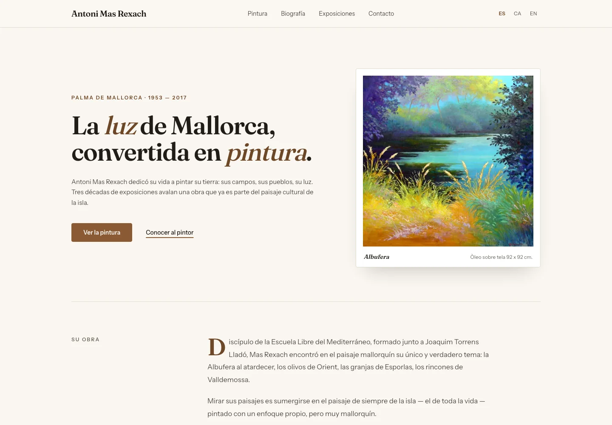

# Antoni Mas Rexach

The official website of Antoni Mas Rexach (1953–2017), a Majorcan painter whose work explores the island’s landscapes, villages and light.

**[Explore the website →](https://masrexach.com)**

[](https://masrexach.com)

## Art, life and exhibitions

- A painting catalogue with individual artwork pages.
- The artist’s biography and exhibition history.
- Spanish, Catalan and English editions.
- A contact form for artwork enquiries.

## Built with care

Built with **Astro**, **TypeScript** and **Tailwind CSS**, deployed on **Cloudflare Workers**. Contact emails are delivered through **Resend**.

The implementation includes responsive artwork images, locally hosted fonts, generated social-sharing cards, and multilingual search metadata. Image sizing and loading decisions are documented in the [image-performance guide](docs/image-performance.md).

## Local development

Use Node.js **22.23.4** (see [`.nvmrc`](.nvmrc)) and pnpm **11.17.0** (see [`package.json`](package.json)).

```sh
pnpm install --frozen-lockfile
pnpm exec playwright install chromium
pnpm dev
```

Open the local URL printed by Astro. Chromium is used to render social-sharing images during builds and by browser-dependent tests.

### Contact emails

Email configuration is optional for browsing the site locally. To send contact emails, copy [`.dev.vars.example`](.dev.vars.example) to `.dev.vars`, supply a Resend API key and sender address, and set the recipient to your own test inbox. Restart the development server after changing these values.

Keep `.dev.vars` private. Local values are not uploaded automatically, and testing the contact form with valid credentials sends real emails.

## Quality checks

| Command            | Purpose                                                        |
| ------------------ | -------------------------------------------------------------- |
| `pnpm lint`        | Check formatting and lint rules                                |
| `pnpm check`       | Check Astro and TypeScript                                     |
| `pnpm test:fast`   | Run tests without browser-dependent social-card cases          |
| `pnpm test`        | Run the full unit-test suite, including browser cases          |
| `pnpm build`       | Build the site and Worker                                      |
| `pnpm verify`      | Run the local pre-push gate                                    |
| `pnpm verify:full` | Include all browser tests and mobile Slow 4G Lighthouse audits |

The pre-push gate also needs Gitleaks, OSV Scanner and actionlint. Full verification needs Chrome or Chromium for Lighthouse. See the [setup requirements](docs/security.md#local-verification-before-publication--2026-11-06) and [verification guide](docs/ci-verification.md) before running it.

## Project guides

- [Contributing](CONTRIBUTING.md)
- [Reporting a vulnerability](SECURITY.md)
- [Verification and test selection](docs/ci-verification.md)
- [Artwork image performance](docs/image-performance.md)
- [Releases and versioning](docs/releases.md)
- [Security runbook](docs/security.md)

## Rights and reuse

The original source code is available under the [MIT License](LICENSE).

**The art and content are not included in that license.** Paintings, artwork reproductions, photographs, editorial text and branding remain reserved by their respective rights holders unless individually stated otherwise. Fonts and other third-party materials retain their own licenses.

See [asset rights and exclusions](ASSET_RIGHTS.md) before reusing material from this repository.
